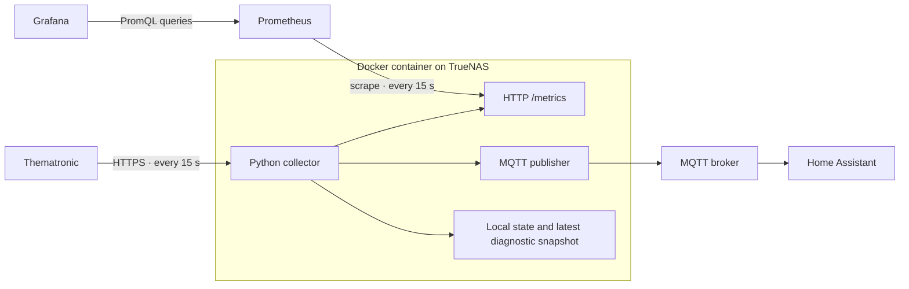

# kotel-reader

**Boiler telemetry from Thematronic to Prometheus and Home Assistant. One Docker container on TrueNAS.**


`kotel-reader` reads the Thematronic website every 15 seconds, exposes current metrics
for Prometheus, and publishes current values over MQTT for Home Assistant.
It is **read-only**: it does not control the boiler or change its settings.

[TrueNAS Apps / YAML import](docs/truenas-apps.md) · [Operations guide](docs/operations.md) · [Configuration](config/config.example.yaml) · [GitHub setup](docs/github.md)

The detailed guides and default sensor labels are currently in Czech.

## How it works



**Prometheus stores the history; Grafana queries Prometheus.** The collector does not
need PostgreSQL, database roles, SQL migrations, or a historical delivery queue.
Prometheus and the MQTT broker run separately from the collector.

## Features

- **Prometheus metrics:** temperatures, durations, numeric values, neutral boolean states, and collector diagnostics at `/metrics`.
- **Home Assistant:** MQTT Discovery with stable entity IDs, Czech labels, and availability for each signal.
- **Freshness handling:** stale, missing, or disconnected readings are omitted from metrics and marked unavailable in HA.
- **Independent outputs:** MQTT outages or missing Prometheus scrapes do not stop collection.
- **Session management:** cooldowns after logout, retry backoff, and local `status`, `pause`, and `resume` commands.
- **Persistent local state:** pauses and cooldowns survive restarts; one diagnostic snapshot preserves the latest raw response.
- **Simple deployment:** YAML configuration, separate credentials, a TrueNAS Apps manifest, and Grafana/HA dashboards.

**There is no backfill.** During a Prometheus outage, intervening readings are not
stored for later delivery. After recovery, Prometheus scrapes the current valid sample.
Text fields and unmapped signals remain in the latest diagnostic snapshot, not in
Prometheus history. Logs can be collected separately by your existing logging stack
(for example, Loki).

## Data quality

The exporter recomputes availability on every scrape. After a pause, confirmed logout,
or the configured reception age limit (60 seconds by default), it omits measurement
series entirely. It never substitutes zero or revives a stored snapshot after restart.
Scraping `/metrics` never triggers a login or a read from Thematronic.

Only explicitly mapped signals with `prometheus: true` are exported. The separate
`publish: true` setting enables their Home Assistant entities. Unknown text values,
sample UUIDs, and raw responses are never used as Prometheus labels.

The HTTP reception time **is not the controller's measurement time**. The known API
response does not establish source freshness, even when HTTP requests succeed.

## Running through TrueNAS Apps

1. Push the project to GitHub, then run **Actions → Publish container image → Run workflow**.
2. Prepare your dataset, [configuration](config/config.example.yaml), [signal mappings](config/signals.yaml), and three credential files.
3. In **Apps → Install via YAML**, paste [truenas-app.yaml](deploy/truenas-app.yaml).
4. Replace the image tag, dataset paths, NAS LAN IP, and published metrics port with your actual settings.
5. Add the [scrape job](deploy/prometheus-scrape.yaml) to your existing Prometheus configuration.
6. Import the [Grafana dashboard](deploy/grafana-dashboard.json), selecting your Prometheus data source.

Follow the [TrueNAS Apps guide](docs/truenas-apps.md) for permissions, image access,
verification, and updates. Port `9108` is the example metrics port; verify that it is
free and allow access from Prometheus on your trusted network. The endpoint has no
built-in authentication or TLS and is not intended for Internet exposure.

## Docker Compose alternative

Copy `config/config.example.yaml` to `config/config.yaml` and `.env.example` to `.env`.
Configure MQTT, your data directory, the NAS LAN bind address, and the three secret
files. UID/GID `10001:10001` must be able to read configuration/secrets and write `/data`.

```sh
docker compose build
docker compose run --rm collector validate
docker compose up -d collector
docker compose logs --tail=100 -f collector
```

There is no PostgreSQL setup or migration step.

## Operations

```sh
docker compose exec collector kotel-reader status
docker compose exec collector kotel-reader pause --minutes 30
docker compose exec collector kotel-reader resume
docker compose exec collector kotel-reader snapshot
```

`snapshot` prints the last received raw and normalized sample for diagnostics, which
may be old. It does not publish that sample. Restart after YAML changes and run only
one collector per Thematronic account.

## Monitoring files

| File | Purpose |
|---|---|
| [Prometheus scrape job](deploy/prometheus-scrape.yaml) | Add the collector to your existing Prometheus |
| [Grafana dashboard](deploy/grafana-dashboard.json) | Temperatures, signal availability, session state, and error rates |
| [Grafana data source](deploy/grafana-datasource.yaml) | Optional Prometheus provisioning example |
| [Home Assistant dashboard](deploy/ha-kotelna.yaml) | Boiler room page without HACS |

Prometheus controls retention and storage. MQTT remains independent of Prometheus
and uses non-retained state messages, retained Discovery, and availability/LWT.

## Validation and commissioning

Tests cover HTTP authentication, session timing, state persistence, MQTT templates,
metric types, stale/missing readings, and an actual HTTP scrape on a loopback server.
An isolated container suite also checks a real Prometheus scrape, dashboard PromQL,
and a real MQTT broker. See the workflow results in GitHub Actions for container checks.
Docker was unavailable during local development; container deployment and dashboard
rendering on the actual NAS still require verification.

No live Thematronic account has been accessed. During commissioning, verify:

- Whether `DeviceSignalReload` is needed and how it should be timed; default `read_only` does not call it.
- Server session lifetime; it is unknown by default, with a 300-second cooldown after logout.
- Authentication error responses and the physical meaning/polarity of ambiguous signals.
- TrueNAS networking, Prometheus target health, and the dashboards in real Grafana/HA instances.

## Development

```sh
python -m venv .venv
# Activate .venv for your operating system.
python -m pip install -r requirements-dev.lock
python -m pytest -q
```

Tests block external network access; the HTTP endpoint test permits loopback only.
For the isolated Prometheus and MQTT integration suite:

```sh
docker build -t kotel-reader:0.2.0 .
docker compose -p kotel-reader-test -f compose.test.yaml up --build --abort-on-container-exit --exit-code-from tests
docker compose -p kotel-reader-test -f compose.test.yaml down -v
```

## Upgrading from version 0.1

Use the new configuration example: remove `postgres` and `queue`, move `mqtt.stale_s`
to `telemetry.stale_s`, add `prometheus`, and update the container's secrets and port
mapping. Old configurations fail validation with an explicit upgrade message.

Existing PostgreSQL data and any old `queue.sqlite` are left untouched. The collector
imports cooldown/pause state from the old file once, but does not replay its historical
samples. Back up old history before retiring the old deployment. See the
[operations guide](docs/operations.md) for details.

## Project structure

```text
kotel_reader/   Collector, sessions, local state, Prometheus, MQTT, and CLI
config/         Example configuration and signal mappings
deploy/         TrueNAS manifest, scrape job, and dashboards
tests/          Offline, loopback, and container integration tests
docs/           Operations, TrueNAS Apps, and GitHub guides
tools/          Grafana dashboard generator
```
