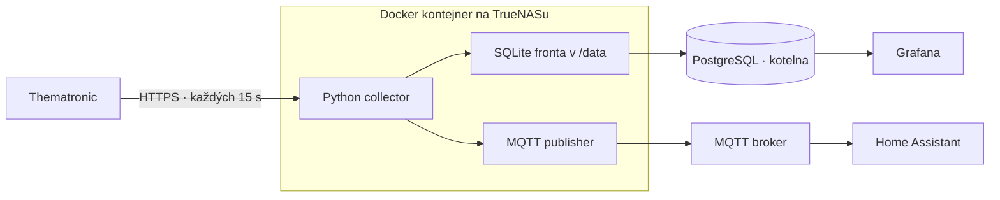

# kotel-reader

**Telemetrie kotle z Thematronicu do PostgreSQL a Home Assistantu. Jeden Docker kontejner na TrueNASu.**


`kotel-reader` načítá signály z webu Thematronic, ukládá historii do existující PostgreSQL
databáze a aktuální hodnoty současně publikuje přes MQTT pro Home Assistant.
Služba je **výhradně čtecí**: neovládá kotel ani nemění jeho nastavení.

[Provozní příručka](docs/operations.md) · [Konfigurace](config/config.example.yaml) · [První push na GitHub](docs/github.md)

## Jak to funguje



PostgreSQL, broker, Grafana a HA běží samostatně. Collector se připojuje k existujícím
službám; nepotřebuje webové GUI ani zveřejněný port.

## Co služba nabízí

- **Historii v PostgreSQL:** jeden snapshot za cyklus, původní JSON, normalizované hodnoty a kvalita dat.
- **Čidla v HA:** MQTT Discovery, české názvy, teploty a dostupnost jednotlivých signálů.
- **Frontu pro výpadky:** persistentní SQLite, doručení bez duplicit a nastavitelné limity.
- **Nezávislé výstupy:** výpadek PostgreSQL nezastaví MQTT ani čtení; výpadek MQTT nezastaví ukládání.
- **Správu relace:** pauzy po odhlášení, backoff a lokální příkazy `status`, `pause`, `resume`.
- **Jednoduché nastavení:** YAML, mapování čidel a hesla odděleně přes secrets / `*_FILE`.
- **Podklady k nasazení:** Compose, SQL migrace, Grafana dashboard a HA dashboard bez HACS.

## Stav projektu

**První implementace; živé zprovoznění ještě zbývá.**

Při ověření první verze prošlo **65 offline testů** a sestavení Python balíčku.
Dva integrační testy potřebují PostgreSQL a MQTT v Dockeru; na vývojovém počítači
nebyl Docker dostupný, proto byly přeskočené. Kontejnerové ověření je připravené v
[GitHub Actions](.github/workflows/test.yaml); výsledek bude dostupný po spuštění workflow.

Skutečný účet nebyl kontaktován. Při zprovoznění ověřte zejména:

- potřebu a časování `DeviceSignalReload` — výchozí `read_only` jej nevolá;
- délku serverové relace — výchozí je neznámá, po odhlášení se čeká 300 s;
- chybové odpovědi webu, význam nejasných signálů a dashboardy v reálném HA/Grafaně.

Čas HTTP příjmu **není čas měření regulátoru**. Čerstvost měření ze známé odpovědi nelze zaručit.

## Spuštění na TrueNASu

Potřebujete Docker Compose, existující PostgreSQL a MQTT broker, účet Thematronic
a persistentní adresář zapisovatelný pro UID/GID `10001:10001`.

1. Zkopírujte [ukázkovou konfiguraci](config/config.example.yaml) do `config/config.yaml`
   a [.env.example](.env.example) do `.env`.
2. Nastavte adresy služeb, cestu datasetu a připravte soubory s přihlašovacími údaji.
3. Vytvořte samostatnou DB `kotelna`, role a spusťte migrace podle [příručky](docs/operations.md).
4. V kořeni projektu spusťte:

```sh
docker compose build
docker compose run --rm collector validate
docker compose up -d collector
docker compose logs --tail=100 -f collector
```

Konfigurace obsahuje příklady konkrétní infrastruktury; před spuštěním je upravte.
Přesný postup včetně oprávnění, migrací, secrets a volitelné macvlan sítě je v
[provozní příručce](docs/operations.md).

## Běžná obsluha

```sh
docker compose exec collector kotel-reader status
docker compose exec collector kotel-reader pause --minutes 30
docker compose exec collector kotel-reader resume
```

Po změně YAML kontejner restartujte. Pro jeden účet provozujte jednu instanci.

## Home Assistant a Grafana

| Výstup | Co připravit |
|---|---|
| Home Assistant | MQTT integraci se stejným brokerem; entity nabídne MQTT Discovery |
| HA dashboard | [Stránka Kotelna](deploy/ha-kotelna.yaml), bez HACS |
| Grafana | PostgreSQL datasource s účtem pouze pro čtení |
| Grafana dashboard | [Importovatelný JSON](deploy/grafana-dashboard.json) a [datasource](deploy/grafana-datasource.yaml) |

Historie z fronty se doručuje pouze do PostgreSQL. Do HA se neposílá jako aktuální stav.

## Vývoj a testy

```sh
python -m venv .venv
# Aktivujte .venv podle svého systému.
python -m pip install -r requirements-dev.lock
python -m pytest -q
```

Unit testy používají mock HTTP a fake clock; síťová spojení mají zakázaná.
Kompletní ověření s pomíjivou testovací DB a brokerem:

```sh
docker build -t kotel-reader:0.1.0 .
docker compose -p kotel-reader-test -f compose.test.yaml up --build --abort-on-container-exit --exit-code-from tests
docker compose -p kotel-reader-test -f compose.test.yaml down -v
```

## Struktura projektu

```text
kotel_reader/   Collector, relace, fronta, PostgreSQL, MQTT a CLI
config/         Ukázková konfigurace a mapování signálů
migrations/     Verzované databázové migrace
deploy/         SQL role, dashboardy a provisioning
tests/          Offline a kontejnerové integrační testy
docs/           Provozní příručka a postup pro GitHub
tools/          Generátor Grafana dashboardu
```

Zálohování, retenci, řešení výpadků a živý checklist najdete v
[provozní příručce](docs/operations.md). Postup nahrání projektu je v
[návodu pro GitHub](docs/github.md).
